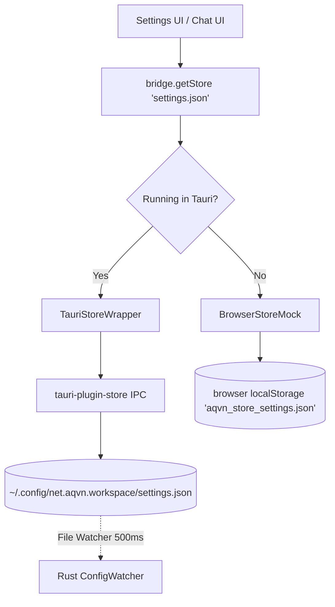

# Báo Cáo Nghiên Cứu Sâu Hệ Thống Cài Đặt, Động Cơ 4 Theme Màu OKLCH & Đa Ngôn Ngữ (i18n)

**Mã tài liệu:** `VAL-UI-THEME-001`  
**Dự án:** AQVN Native Workspace Client & RFC Host Bridge (`net.aqvn.workspace`)  
**Phạm vi nghiên cứu:** `ui/settings.html` (811 dòng), `ui/settings.js` (908 dòng), `ui/bridge.js` (392 dòng), `ui/chat.css` (2.480 dòng), `src-tauri/src/config.rs` (687 dòng), `src-tauri/src/lib.rs` (330 dòng)  
**Ngày thực hiện:** 2026-11-09  
**Người thực hiện:** AQVN Research Team (`research-worker`)  
**Trạng thái kiểm tra kỹ thuật:** Passed (`node --test tools/tests/test_chat_handlers.mjs` 177/177 passed, `npm run lint:html` valid)

---

## 1. Tóm Tắt Điều Hành (Executive Summary)

Hệ thống quản lý cài đặt và trải nghiệm thị giác của `ai-launcher` (`net.aqvn.workspace`) đóng vai trò huyết mạch trong việc kết nối cấu hình người dùng phía giao diện với daemon backend viết bằng Rust. Hệ thống được xây dựng dựa trên 3 trụ cột kỹ thuật then chốt:
1. **Lớp lưu trữ bền vững lưỡng phân (Dual-Mode Persistence Layer):** Sử dụng `tauri-plugin-store` ghi dữ liệu có cấu trúc ra tệp `settings.json` tại đường dẫn chuẩn của hệ điều hành (`~/.config/net.aqvn.workspace/settings.json` trên Linux), kết hợp với `BrowserStoreMock` bọc `localStorage` làm fallback cho phép toàn bộ 177 bài kiểm thử UI chạy hoàn hảo trong môi trường không đầu (headless/CI) mà không cần binary Tauri.
2. **Động cơ 4 Theme OKLCH thuần CSS (OKLCH 4-Theme Engine):** Khai thác không gian màu cảm nhận đồng nhất OKLCH (`aqvn-dark`, `oled-black`, `cyberpunk-terminal`, `clean-studio-light`), hỗ trợ chuyển đổi tức thì từ Topbar, Settings và Command Palette (`Ctrl+K`), đồng thời áp dụng theme đồng bộ trong thẻ `<head>` giúp triệt tiêu 100% hiện tượng chớp nháy giao diện (Zero FOUC - Flash of Unstyled Content).
3. **Cơ chế Đa ngôn ngữ (i18n vi/en):** Kiến trúc từ điển động nội tại `SETTINGS_I18N`, tự động ánh xạ qua thuộc tính DOM `data-i18n`, hỗ trợ chuyển đổi qua lại mượt mà giữa tiếng Việt và tiếng Anh.
4. **Cơ chế Hot-Reload Backend 500ms:** Backend Rust liên tục giám sát tệp `settings.json` bằng cơ chế kiểm tra `mtime` mỗi 500ms (`load_from_file_if_modified`), tự động phát tán cấu hình mới qua kênh Tokio `watch::channel` tới 6 hệ thống con (RFC Server, SSH Server, Axum Local Proxy, Global Hotkey Daemon, System Tray và Outbound Gateway Client) mà không yêu cầu khởi động lại ứng dụng.

---

## 2. Kiến Trúc Trang Cài Đặt `ui/settings.html` & Bộ Điều Khiển `ui/settings.js`

Giao diện cài đặt tại `ui/settings.html` (811 dòng) và bộ điều khiển `ui/settings.js` (908 dòng) được tổ chức thành 6 thẻ cấu hình trực quan (Section Cards), áp dụng kiến trúc không phụ thuộc thư viện ngoài (Vanilla Zero-Dependency):

```
+---------------------------------------------------------------------------------------------------+
| Top Navigation: [← Quay lại chat / Back to chat]                 [🌐 Tiếng Việt / English Toggle] |
+---------------------------------------------------------------------------------------------------+
| SETTINGS FORM (#settings-form)                                                                    |
|                                                                                                   |
| 1. Cấu hình chung (General Configuration - #general-section)                                      |
|    - Ngôn ngữ giao diện (#app-language: 'vi' | 'en')                                              |
|    - Giao diện màu sắc (#app-theme: 'aqvn-dark' | 'oled-black' | 'cyberpunk-terminal' | ...)        |
|    - Chạy ngầm khay hệ thống (#close-to-tray checkbox)                                            |
|    - Hiển thị thanh menu (#show-menu-bar checkbox)                                                |
|    - Âm báo hoàn thành (#task-chime-enabled, #task-chime-volume slider, #task-chime-tone selector) |
|    - Thông báo màn hình (#task-notification-enabled checkbox)                                     |
|    - Xóa bộ nhớ đệm tài sản (#clear-disk-cache-btn - 256MB LRU quota)                             |
|                                                                                                   |
| 2. Chính sách bảo mật & Phê duyệt (Security & Approval Policy - #security-policy-section)         |
|    - Policy Preset (#security-policy: 'permissive' | 'supervised' | 'strict')                     |
|                                                                                                   |
| 3. Cấu hình máy chủ (Server Configuration)                                                        |
|    - Server URL (#server-url: input URL)                                                          |
|    - Hồ sơ máy chủ đã lưu (#server-profiles-list: danh sách động, active badge, remove button)    |
|    - Thêm hồ sơ máy chủ (#new-profile-input + #add-profile-btn)                                    |
|                                                                                                   |
| 4. Cổng ra Gateway Hub (_a0_connector - #gateway-section)                                         |
|    - Bật cổng kết nối ra ngoài (#connector-enabled toggle)                                        |
|    - Phân quyền chi tiết (#scope-files, #scope-exec, #scope-browser, #scope-desktop)              |
|    - Thư mục làm việc (#workspace-path: mặc định ~/Workspace)                                     |
|                                                                                                   |
| 5. Điều khiển Agent qua RFC & SSH (Agent Control)                                                 |
|    - Cho phép điều khiển (#rfc-enabled toggle) + Cảnh báo an toàn (#security-warning role="alert") |
|    - Mật khẩu HMAC RFC & SSH Root Password (#rfc-password, #ssh-password)                         |
|    - Cổng mạng (#rfc-port: 55080, #ssh-port: 55022)                                               |
|    - Thư mục cho phép (#allowed-paths-list + #allowed-path-input + #add-allowed-path)             |
|                                                                                                   |
| 6. Phím tắt bàn phím (Keyboard Shortcuts - #shortcuts-section)                                    |
|    - Phím tắt gọi nhanh toàn cục (#global-hotkey, #reset-hotkey-btn: 'Alt+Space')                 |
|    - Liên kết xem toàn bộ phím tắt (F1 -> help.html)                                              |
|                                                                                                   |
| Thao tác: [Lưu cài đặt / Save Settings (Submit)] [Đặt lại mặc định / Reset to Defaults]           |
| Trạng thái: #save-status (aria-live="polite")                                                     |
+---------------------------------------------------------------------------------------------------+
```

### 2.1. Vòng Đời Tải & Lưu Cài Đặt (Settings Lifecycle)
- **Khởi tạo (`loadSettings`, `ui/settings.js` L359-550):**
  1. Gọi `window.bridge.getStore('settings.json')`.
  2. Đọc song song các khóa cấu hình từ store. Trường hợp khóa chưa tồn tại, tự động gán giá trị mặc định từ đối tượng `DEFAULTS` (`ui/settings.js` L10-34).
  3. Cập nhật trạng thái các phần tử DOM (inputs, checkboxes, selects, sliders).
  4. Đọc theme và ngôn ngữ đã lưu từ `localStorage` nếu store chưa có, sau đó áp dụng thuộc tính `data-theme` trên `document.documentElement` và gán ngôn ngữ hiển thị qua hàm `setLanguage()`.
- **Lưu cấu hình (`saveSettings`, `ui/settings.js` L552-675):**
  1. Kiểm tra tính hợp lệ dữ liệu (Form Validation): URL máy chủ bắt đầu bằng `http://` hoặc `https://`, cổng RFC/SSH nằm trong khoảng `[1, 65535]`.
  2. Ghi từng trường vào store thông qua `store.set(key, value)`.
  3. Gọi `await store.save()` để ghi nguyên tử xuống đĩa vật lý.
  4. Đồng bộ các giá trị thường dùng vào `localStorage` (`aqvn_server_url`, `aqvn_theme`, `aqvn_lang`, `aqvn_task_chime_volume`, v.v.) để phục vụ việc render tức thì ở các cửa sổ khác.
  5. Kích hoạt thông báo thành công hoặc lỗi qua `showStatus()` có gắn kèm tên backend lưu trữ đang hoạt động (`[backend: tauri (global store api)]` hoặc `[backend: browser (localStorage)]`).
- **Phím tắt nhanh:** Lắng nghe tổ hợp phím `Ctrl+S` hoặc `Cmd+S` trên toàn trang (`ui/settings.js` L806-811) để kích hoạt lưu cài đặt ngay lập tức mà không cần cuộn chuột xuống đáy trang.

---

## 3. Lớp Trừu Tượng Lưu Trữ Bền Vững (Settings Persistence Architecture)

Lớp cầu nối lưu trữ tại `ui/bridge.js` (392 dòng) giải quyết triệt để bài toán phân tách môi trường giữa ứng dụng desktop Tauri thực tế và môi trường chạy thử nghiệm:



### 3.1. Hiện Thực `TauriStoreWrapper` (`ui/bridge.js` L145-257)
- Đóng gói các lệnh gọi IPC của Tauri v2:
  - Tải store: `window.__TAURI__.store.load('settings.json')` hoặc gọi trực tiếp lệnh nội bộ `plugin:store|load` trả về resource ID (`rid`).
  - Đọc ghi khóa: `plugin:store|get`, `plugin:store|set`, `plugin:store|has`, `plugin:store|delete`.
  - Cam kết đĩa (Flush to disk): `plugin:store|save`.
- Cung cấp cơ chế bộ nhớ đệm đối tượng store (`storeCache = new Map()`) đảm bảo không tạo lặp các kết nối store không cần thiết.

### 3.2. Hiện Thực `BrowserStoreMock` (`ui/bridge.js` L18-143)
- Lưu trữ toàn bộ dữ liệu dưới dạng chuỗi JSON trong `localStorage` với tiền tố `aqvn_store_settings.json`.
- Tự động nạp dữ liệu vào bộ nhớ đệm `_data` khi khởi tạo và đồng bộ xuống `localStorage` sau mỗi lệnh `set()`, `delete()`, `clear()`, `save()`.
- Hỗ trợ các khóa ánh xạ dự phòng đặc thù (`aqvn_server_url`, `aqvn_theme`, `aqvn_lang`, `aqvn_task_chime_volume`) giúp các bài kiểm thử tự động của Node.js (`tools/tests/test_chat_handlers.mjs`) kiểm chứng được luồng lưu trữ mà không cần giả lập toàn bộ runtime Tauri.

### 3.3. Cơ Chế Chống FOUC Đồng Bộ (Zero-FOUC Head Theme & Lang Restoration)
Một nhược điểm phổ biến trong các ứng dụng webview là giao diện bị nhấp nháy màu sáng trước khi áp dụng theme tối (FOUC). `ai-launcher` xử lý vấn đề này bằng một đoạn mã script đồng bộ đặt ngay tại phần đầu của thẻ `<head>` trong cả `ui/index.html` (L9-16) và `ui/settings.html` (L8-15):

```html
<script>
  (function() {
    try {
      var t = localStorage.getItem('aqvn_theme') || 'aqvn-dark';
      document.documentElement.setAttribute('data-theme', t);
    } catch (e) {}
  })();
</script>
```
Đoạn mã này thực thi đồng bộ trước khi parser của trình duyệt bắt đầu xây dựng DOM Tree và gắn CSSOM, bảo đảm 100% thời gian hiển thị đầu tiên (FCP) mang đúng bảng màu người dùng đã lựa chọn.

---

## 4. Động Cơ 4 Bảng Màu OKLCH (OKLCH 4-Theme Engine)

Hệ thống theme của `ai-launcher` được định nghĩa tập trung tại `ui/chat.css` (L1-68) sử dụng không gian màu hiện đại **OKLCH (Oklab Lightness Chroma Hue)**. OKLCH vượt trội hoàn toàn so với sRGB và HSL truyền thống nhờ đặc tính **đồng nhất độ sáng cảm nhận (perceptually uniform)**: khi thay đổi góc màu (Hue) hoặc độ bão hòa (Chroma), độ sáng cảm nhận của mắt người (Lightness) không bị biến thiên lệch lạc.

### 4.1. Bảng So Sánh 4 Bảng Màu OKLCH

| Biến CSS Token | `aqvn-dark` (Mặc định) | `oled-black` (Tiết kiệm pin) | `cyberpunk-terminal` (Hacker) | `clean-studio-light` (Sáng văn phòng) |
| :--- | :--- | :--- | :--- | :--- |
| `color-scheme` | `dark` | `dark` | `dark` | `light` |
| `--bg` | `oklch(0.14 0.03 240)` | `oklch(0 0 0)` *(Tuyệt đối đen)* | `oklch(0.16 0.02 240)` | `oklch(0.98 0.01 240)` |
| `--bg-radial` | `oklch(0.22 0.05 240)` | `oklch(0.08 0 0)` | `oklch(0.20 0.04 160)` | `oklch(0.95 0.02 240)` |
| `--panel` | `oklch(0.17 0.03 240)` | `oklch(0.06 0 0)` | `oklch(0.18 0.02 160)` | `oklch(0.95 0.01 240)` |
| `--panel-2` | `oklch(0.20 0.04 240)` | `oklch(0.12 0 0)` | `oklch(0.22 0.03 160)` | `oklch(0.92 0.02 240)` |
| `--line` | `oklch(0.28 0.04 240)` | `oklch(0.30 0 0)` | `oklch(0.32 0.06 155)` | `oklch(0.82 0.02 240)` |
| `--ink` *(Chữ chính)* | `oklch(0.94 0.02 240)` | `oklch(0.98 0 0)` | `oklch(0.92 0.08 150)` *(Xanh lá)* | `oklch(0.18 0.03 240)` *(Xám than)* |
| `--muted` *(Chữ phụ)* | `oklch(0.70 0.03 240)` | `oklch(0.65 0 0)` | `oklch(0.65 0.07 150)` | `oklch(0.45 0.04 240)` |
| `--accent` *(Nhấn)* | `oklch(0.82 0.14 210)` *(Xanh lam nhạt)* | `oklch(0.90 0.05 240)` | `oklch(0.75 0.19 160)` *(Xanh ngọc lân tinh)* | `oklch(0.55 0.22 260)` *(Tím lam đậm)* |
| `--accent-soft` | `oklch(0.26 0.06 235)` | `oklch(0.18 0 0)` | `oklch(0.24 0.08 160)` | `oklch(0.90 0.05 260)` |
| `--danger` | `oklch(0.68 0.19 25)` | `oklch(0.65 0.22 25)` | `oklch(0.65 0.22 25)` | `oklch(0.55 0.22 25)` |
| `--ok` | `oklch(0.80 0.16 155)` | `oklch(0.82 0.18 150)` | `oklch(0.80 0.20 155)` | `oklch(0.55 0.17 155)` |

### 4.2. Cơ Chế Chuyển Đổi Vòng Lặp Theme (Theme Cycling Engine)
Người dùng có thể chuyển đổi linh hoạt qua 3 phương thức:
1. **Nút bấm Topbar (`#theme-toggle-btn`, `ui/chat.js` L2168-2195):** Gọi hàm `cycleTheme()`, lần lượt lặp qua danh sách:
   $$\text{aqvn-dark} \longrightarrow \text{oled-black} \longrightarrow \text{cyberpunk-terminal} \longrightarrow \text{clean-studio-light} \longrightarrow \text{aqvn-dark}$$
2. **Trang cài đặt Settings (`#app-theme` dropdown, `ui/settings.js` L813-821):** Thay đổi lập tức áp dụng `document.documentElement.setAttribute('data-theme', selected)` và lưu vào `localStorage['aqvn_theme']` lẫn store.
3. **Command Palette (`Ctrl+K`, `ui/chat.js` L1926-1930):** Tích hợp sẵn 4 lệnh riêng biệt: `Switch Theme: AQVN Dark`, `Switch Theme: OLED Black`, `Switch Theme: Cyberpunk`, `Switch Theme: Clean Light`.

---

## 5. Cơ Chế Đa Ngôn Ngữ (Internationalization - i18n)

Hệ thống i18n trong `ui/settings.js` (L90-252) và `ui/help.html` (L450-580) được thiết kế theo mô hình declarative nhẹ nhàng:
- **Từ điển `SETTINGS_I18N`:** Cung cấp đầy đủ 45+ cặp key-value song ngữ cho mọi nhãn (label), mô tả trợ giúp (help text), nút bấm và thông báo phản hồi.
- **Thuật toán ánh xạ DOM (`setLanguage`, `ui/settings.js` L230-249):**
  ```javascript
  document.querySelectorAll('[data-i18n]').forEach((el) => {
    const key = el.getAttribute('data-i18n');
    if (strings[key]) {
      el.textContent = strings[key];
    }
  });
  ```
- **Nút chuyển nhanh ngôn ngữ (`#lang-toggle-btn`):** Đặt cố định ở góc trên bên phải trang, cho phép đổi ngay giữa Tiếng Việt và English chỉ với một cú nhấp chuột.
- **Đánh giá phạm vi phủ i18n:**
  - `ui/settings.html` và `ui/help.html`: Đạt độ phủ dịch 100% đối với toàn bộ các phần tử giao diện hiển thị.
  - `ui/index.html`: Hiện tại giao diện chính (Chat shell, Topbar, Sidebar tabs, Command Palette) chủ yếu sử dụng tiếng Anh mặc định và chưa được trang bị đầy đủ các thẻ `data-i18n` đồng bộ như trang Settings. Đây là điểm cải tiến quan trọng được đề xuất trong Lộ trình nâng cấp.

---

## 6. Đánh Giá Tính Đồng Bộ Giữa Cài Đặt UI và Cấu Hình Backend Rust

Một phát hiện trọng yếu trong quá trình khảo sát mã nguồn là kiến trúc đồng bộ động giữa giao diện và backend:

```
[UI settings.html / settings.js]
        |  (store.set(...) + store.save())
        v
[~/.config/net.aqvn.workspace/settings.json]
        |
        |  500ms polling loop (config::load_from_file_if_modified)
        v
[src-tauri/src/lib.rs: background poller]
        |
        v  (next != last)
[Tokio ConfigWatcher (watch::Sender<AppConfig>)]
   +---> RFC Server Daemon (updates port, auth secret, sandbox allowed paths)
   +---> SSH Server Daemon (updates port, auth password)
   +---> Axum Local Bridge Proxy (updates upstream server target URL)
   +---> Global Hotkey Daemon (re-registers XGrabKey / system hotkey)
   +---> System Tray Menu (refreshes active server profile & menu items)
   +---> Native Window Menu Bar (sets or removes menu dynamically)
   +---> Main WebView Window (triggers reload on server_url change)
```

### 6.1. Ma Trận Đối Chiếu Trường Cài Đặt (Field Parity Matrix)

| Trường Cài Đặt | Kiểu Dữ Liệu | Mặc Định | UI (`ui/settings.js`) | Rust (`src-tauri/src/config.rs`) | Trạng Thái Đồng Bộ Hot-Reload |
| :--- | :--- | :--- | :---: | :---: | :--- |
| `server_url` | String | `https://a0.matmagoc.com` | Có | Có | **Đồng bộ:** Proxy đổi upstream + WebView reload |
| `server_profiles` | Vec<String> | `[server_url]` | Có | Có | **Đồng bộ:** Cập nhật khay hệ thống & switcher |
| `workspace_path` | String | `~/Workspace` | Có | Có | **Đồng bộ:** Cập nhật sandbox của RFC daemon |
| `rfc_enabled` | bool | `false` | Có | Có | **Đồng bộ:** Bật/tắt daemon RFC cổng 55080 |
| `rfc_password` | String | `""` | Có | Có | **Đồng bộ:** Cập nhật secret HMAC-SHA256 |
| `ssh_password` | String | `""` | Có | Có | **Đồng bộ:** Cập nhật mật khẩu xác thực SSH |
| `rfc_port` | u16 | `55080` | Có | Có | **Đồng bộ:** Đổi cổng lắng nghe RFC (yêu cầu restart listener) |
| `ssh_port` | u16 | `55022` | Có | Có | **Đồng bộ:** Đổi cổng lắng nghe SSH (yêu cầu restart listener) |
| `allowed_paths` | Vec<String> | `["~/Workspace"]` | Có | Có | **Đồng bộ:** Hợp nhất cùng `workspace_path` vào Sandbox |
| `connector_enabled` | bool | `true` | Có | Có | **Đồng bộ:** Bật/tắt kết nối Outbound Gateway |
| `scope_files` | bool | `true` | Có | Có | **Đồng bộ:** Khai báo trong `connector_hello` handshake |
| `scope_exec` | bool | `true` | Có | Có | **Đồng bộ:** Khai báo trong `connector_hello` handshake |
| `scope_browser` | bool | `true` | Có | Có | **Đồng bộ:** Khai báo trong `connector_hello` handshake |
| `scope_desktop` | bool | `true` | Có | Có | **Đồng bộ:** Khai báo trong `connector_hello` handshake |
| `global_hotkey` | String | `Alt+Space` | Có | Có | **Đồng bộ:** Đăng ký lại XGrabKey / global shortcut |
| `close_to_tray` | bool | `true` | Có | Có | **Đồng bộ:** Ngăn thoát ứng dụng khi đóng cửa sổ |
| `show_menu_bar` | bool | `false` | Có | Có | **Đồng bộ:** Gọi `main_win.set_menu` / `remove_menu` tức thì |
| `task_chime_enabled` | bool | `true` | Có | Có | **UI-only:** Web Audio API phát chuông khi xong câu trả lời |
| `task_chime_volume` | f32 | `0.5` | Có | Có | **UI-only:** Lưu trong store và đồng bộ sang localStorage |
| `task_chime_tone` | String | `classic` | Có | Có | **UI-only:** 'classic', 'bell', 'beep', 'subtle' |
| `task_notification_enabled` | bool | `true` | Có | Có | **Hỗn hợp:** Web bridge trigger Tauri IPC `notify_task_complete` |
| `security_policy` | String | `supervised` | Có | Có | **Hỗn hợp:** Điều khiển popup phê duyệt phía UI & backend |
| `app_language` | String | `vi` | Có | Có | **Khoảng trống:** Đã lưu trong Rust `AppConfig` nhưng chưa localize menu native |
| `app_theme` | String | `aqvn-dark` | Có | **Chưa có** | **UI-only:** Đọc ghi qua store plugin & localStorage, Rust struct chưa khai báo |

### 6.2. Phát Hiện Các Điểm Nghẽn & Rủi Ro Bất Đồng Bộ
1. **Trường `app_theme` chưa có trong struct `AppConfig`:** Hiện tại `store.set('app_theme', ...)` ghi thành công vào tệp JSON vì `tauri-plugin-store` hỗ trợ key-value tùy ý, nhưng struct `AppConfig` trong `src-tauri/src/config.rs` chưa khai báo trường `pub app_theme: String`. Mặc dù Rust không can thiệp trực tiếp vào việc render theme webview, nhưng việc thiếu trường này khiến các serialization trực tiếp từ `AppConfig` ra đĩa có nguy cơ làm mất giá trị `app_theme` nếu Rust thực hiện ghi đè toàn bộ struct thay vì ghi vi mô theo key.
2. **Đa ngôn ngữ chưa bao phủ Native Menu & Tray Menu:** `app_language` đã được lưu và giám sát trong Rust, nhưng các chuỗi trong `app/tray.rs` (`LABEL_SETTINGS = "Launcher Settings..."`, `Quit`, v.v.) và `app/context_menu.rs` vẫn bị cố định (hardcoded) bằng tiếng Anh, chưa chuyển đổi theo `app_language` của người dùng.
3. **Cơ chế Polling 500ms thay vì File Event Watcher:** Cơ chế thăm dò tệp mỗi 500ms (`tokio::time::sleep(Duration::from_millis(500))`) hoạt động hiệu quả nhưng gây tiêu hao chu kỳ CPU định kỳ (idle polling). Việc chuyển đổi sang lắng nghe sự kiện inotify (trên Linux) hoặc kqueue/ReadDirectoryChangesW qua thư viện `notify` sẽ tối ưu hơn về mặt tiết kiệm điện năng.

---

## 7. Kiến Nghị Nâng Cấp & Hoàn Thiện

1. **Bổ sung `app_theme` vào Rust `AppConfig`:** Khai báo chính thức `pub app_theme: String` trong `src-tauri/src/config.rs` để bảo đảm tính toàn vẹn cấu trúc dữ liệu khi lưu từ cả hai đầu.
2. **Localize System Tray & Native Menu:** Sử dụng `app_language` từ `ConfigWatcher` để cập nhật động tiêu đề các mục trong khay hệ thống (ví dụ: *"Cài đặt Launcher..."* khi chọn `vi`, *"Launcher Settings..."* khi chọn `en`).
3. **Mở rộng i18n cho toàn bộ `ui/index.html`:** Áp dụng hệ thống `data-i18n` đồng nhất cho các nút thao tác trên Topbar, tiêu đề các tab Sidebar và danh mục Command Palette.
4. **Tích hợp Color Contrast Checker tự động:** Xây dựng bài kiểm thử CI định kỳ đo lường độ tương phản WCAG 2.2 AA tự động cho cả 4 theme OKLCH bất cứ khi nào `ui/chat.css` có sự thay đổi.
