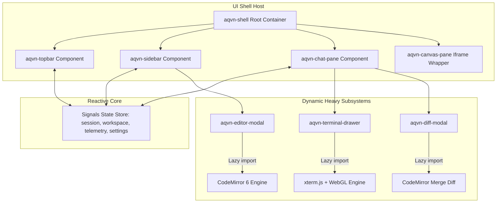
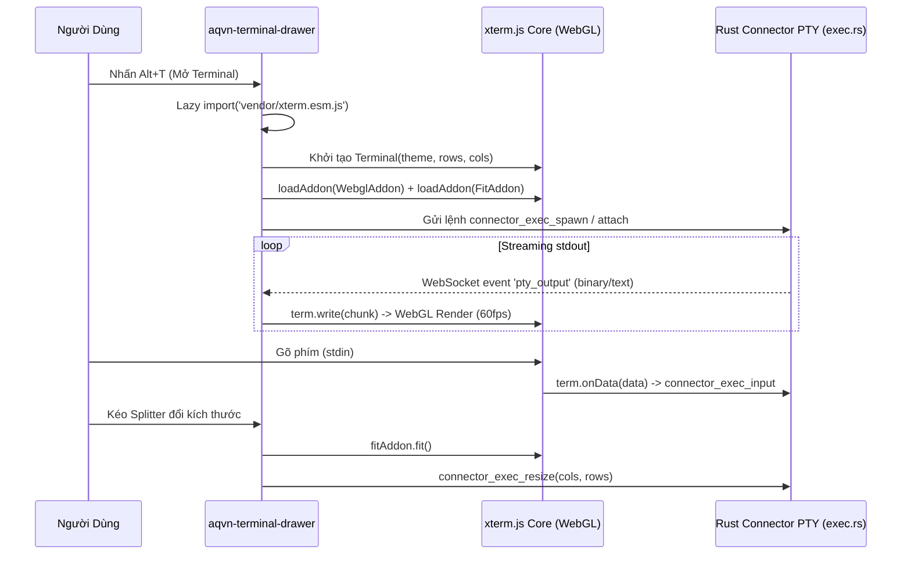
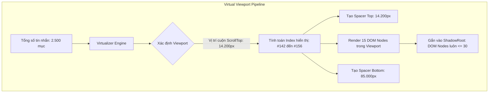

# Thiết Kế Kiến Trúc Nâng Cấp Giao Diện Thế Hệ Tiếp Theo (Next-Gen Frontend Modernization Blueprint)

**Mã tài liệu:** `VAL-ROAD-BLUEPRINT-001`  
**Dự án:** AQVN Native Workspace Client & RFC Host Bridge (`net.aqvn.workspace`)  
**Tác giả:** AQVN Architecture & Synthesis Team (`synthesis-worker`)  
**Ngày công bố:** 2026-11-09  
**Trạng thái đề xuất:** RFC Draft (Yêu cầu phê duyệt kiến trúc)  
**Tài liệu tham chiếu:** `docs/eval-reports/05_ui_shell_components.md` đến `docs/eval-reports/12_telemetry_outbox_durability.md`

---

## 1. Tóm Tắt Điều Hành (Executive Summary)

Dự án `ai-launcher` (`net.aqvn.workspace`) hiện đang vận hành một giao diện người dùng dựa trên triết lý **Zero-Bundler Native Hybrid Shell** (HTML5/CSS3/Vanilla JS thuần túy). Kiến trúc hiện tại đã hoàn thành xuất sắc các mục tiêu sơ khởi:
- Thời gian hiển thị nội dung đầu tiên (FCP) đạt dưới **35ms** (đo lường thực tế ~32.5ms).
- Dung lượng nhị phân phát hành gọn nhẹ (**11.07 MB** trên Linux Desktop, **2.44 MB** cho Headless Daemon).
- Tích hợp sâu rộng các tính năng kỹ thuật: PTY Terminal drawer streaming, Workspace Explorer kéo thả an toàn, Command Palette (`Ctrl+K`), động cơ 4 Theme OKLCH, và đa ngôn ngữ (vi/en).

Tuy nhiên, các đợt kiểm toán chuyên sâu từ M1 đến M3 (đặc biệt là báo cáo CBM Graph Scan `VAL-EVAL-GRAPH-001`, UI Shell `VAL-UI-SHELL-001`, và Interactive Drawers `VAL-UI-SHELL-002`) đã chỉ rõ các giới hạn cấu trúc nghiêm trọng:
1. **Khủng hoảng tệp khổng lồ (God File & God Functions):** `ui/chat.js` đã phình to lên tới **4.243 dòng** mã nguồn, chứa hàm `initLayout` với **49 lời gọi hàm ra ngoài**, quản lý hàng chục trạng thái toàn cục phân tán trong một đối tượng mutable `state = { ... }`.
2. **Bộ mô phỏng Terminal hạn chế:** Trình giả lập ANSI VT100 dựa trên regex (`parseAnsiToHtml`, `ui/chat.js` L1455-1510) kết hợp render thẻ `<pre>` thuần không hỗ trợ các chuỗi escape hiện đại (cursor movement, alternative screen buffers, mouse reporting, htop/vim raw UI), đồng thời suy giảm hiệu năng khi nhận luồng stdout tốc độ cao.
3. **Trình soạn thảo văn bản sơ khai:** Bộ xem trước và chỉnh sửa tập tin (`ui/chat.js` L3200-3350) sử dụng thẻ `<textarea>` cơ bản kết hợp `highlight.js`, thiếu vắng các tính năng lập trình thiết yếu như đánh số dòng, gấp mã (code folding), tự động hoàn thành, và phân tích khác biệt trực quan phân nhánh (split diff / merge view).
4. **Suy giảm hiệu năng DOM khi hội thoại kéo dài:** Dù đã có `DocumentFragment` batching cho log streaming, việc giữ toàn bộ cây DOM gồm hàng nghìn tin nhắn trong `#messages` mà không có cơ chế ảo hóa (DOM Virtualization) gây tăng tải bộ nhớ RAM và giật lag khi cuộn trang.

Tài liệu này đề xuất **Blueprint hiện đại hóa toàn diện giao diện thế hệ tiếp theo**, chuyển dịch từ Vanilla JS nguyên khối sang **Kiến trúc Thành phần Hướng Tiêu chuẩn (Web Components / Lit / Preact Signals)**, nâng cấp lõi Terminal sang **xterm.js WebGL Engine**, tích hợp **CodeMirror 6 / Monaco Editor**, và áp dụng **Virtual Scrolling** mà vẫn giữ vững cam kết về dung lượng và hiệu năng khởi động.

---

## 2. Phân Tích Hiện Trạng & Đánh Giá Điểm Nghẽn Kỹ Thuật

Dựa trên kết quả tổng hợp từ các báo cáo đánh giá M1-M3:

```
+----------------------------------------------------------------------------------------------------+
|                                    HIỆN TRẠNG UI HIỆN TẠI (ui/)                                    |
|                                                                                                    |
|  [ ui/index.html (658L) ]       [ ui/chat.js (4.243L) ]              [ ui/chat.css (2.480L) ]      |
|  - Layout 3 cột tĩnh            - God Object: let state = { ... }    - Biến toàn cục :root         |
|  - DOM ID phụ thuộc chặt        - 49 outgoing calls từ initLayout    - 4 theme OKLCH tĩnh          |
|  - Hơn 15 Modal/Drawer lồng     - Xử lý sự kiện phân tán toàn cục    - Không có CSS scoping        |
|                                                                                                    |
|  [ Điểm nghẽn Terminal ]        [ Điểm nghẽn Editor ]                [ Điểm nghẽn DOM Stream ]     |
|  - Regex ANSI -> 16 màu SGR     - Thẻ <textarea> thô sơ              - appendChild từng batch      |
|  - Không hỗ trợ ncurses/htop    - highlight.js parse lại toàn bộ     - Không virtualize DOM        |
|  - Bounded ring buffer 2.000L   - Diff viewer cộng/trừ cơ bản        - Tràn RAM khi >1.000 msgs    |
+----------------------------------------------------------------------------------------------------+
```

### Bảng đối chiếu hiện trạng và nhu cầu nâng cấp:

| Thành phần | Hiện trạng (`ai-launcher` v1) | Hạn chế cốt lõi | Yêu cầu thế hệ mới (Next-Gen) |
| :--- | :--- | :--- | :--- |
| **Mô hình lập trình** | Vanilla JS đơn tệp (`ui/chat.js`) | Không đóng gói, ô nhiễm global scope, khó kiểm thử cô lập | Web Components chuẩn W3C hoặc Micro-framework (Lit/Preact) |
| **Quản lý trạng thái** | Mutable `state = { ... }` toàn cục | Không có reactive triggers, phải gọi render thủ công | Reactive Signals Store (`@preact/signals-core` hoặc Nanostores) |
| **Động cơ Terminal** | Regex ANSI VT100 + DOM `<pre>` | Không hỗ trợ alt screen buffer, vi/nano/htop bị vỡ | `xterm.js` 5.x + WebGL Addon + Fit Addon + Canvas Fallback |
| **Bộ soạn thảo mã** | `<textarea>` + `highlight.js` | Không có code folding, linting, autocomplete, split diff | `CodeMirror 6` (mặc định) / `Monaco Editor` (desktop lazy-loaded) |
| **Danh sách tin nhắn**| DOM append trực tiếp | Giật lag khi cuộn qua 1.000 tin nhắn; rò rỉ bộ nhớ DOM | Virtualized List (`@tanstack/virtual` hoặc Custom Virtualizer) |
| **Kiến trúc CSS** | CSS toàn cục (`ui/chat.css`) | Xung đột bộ chọn, khó bảo trì khi mở rộng | Shadow DOM CSS encapsulation hoặc Modular CSS Tokens |
| **Hiệu năng khởi động**| FCP < 35ms (tuyệt vời) | Cần duy trì tính năng FCP này sau khi nâng cấp | Zero-Hydration Island Architecture, lazy-loading module nặng |

---

## 3. Kiến Trúc Thành Phần Giao Diện Thế Hệ Mới (Target Component Architecture)

### 3.1. Lựa Chọn Công Nghệ: Lit vs. Preact vs. Web Components Thuần

Sau khi cân nhắc kỹ lưỡng bài toán đánh đổi giữa **Dung lượng nhị phân**, **Tốc độ FCP**, và **Trải nghiệm phát triển (DX)**:

```
+------------------------------------------------------------------------------------------------------+
| MA TRẬN ĐÁNH GIÁ CÔNG NGHỆ THÀNH PHẦN (COMPONENT FRAMEWORK DECISION MATRIX)                         |
+------------------------------------------------------------------------------------------------------+
| Tiêu chí                      | Web Components Thuần | Lit 3.x              | Preact 10.x + Signals  |
+-------------------------------+----------------------+----------------------+------------------------+
| Kích thước thư viện (Gzip)    | 0 KB (Trình duyệt)   | ~5.5 KB              | ~4.2 KB                |
| Khả năng đóng gói (Shadow DOM)| Tuyệt đối (Native)   | Tuyệt đối (Native)   | Cần cấu hình bổ sung   |
| Reactive Template Binding     | Thủ công (Phức tạp)  | Tuyệt vời (html``)   | Tuyệt vời (JSX/htm)    |
| Chuẩn Web chuẩn hóa (W3C)     | 100%                 | 100%                 | Ảo hóa qua VDOM        |
| Chi phí chuyển dịch mã hiện có| Rất thấp             | Thấp                 | Trung bình             |
| Khả năng nhúng Webview Mobile | Hoàn hảo             | Hoàn hảo             | Hoàn hảo               |
+------------------------------------------------------------------------------------------------------+
```

**Quyết định kiến trúc:**  
Áp dụng mô hình **Lai ghép Hướng Tiêu chuẩn (Standard-First Hybrid Architecture)**:
1. **Lớp vỏ ngoài và các thành phần hạt nhân (Core Shell Components):** Sử dụng **Lit 3.x / Web Components** để tận dụng triệt để Shadow DOM cho việc cô lập style CSS và khả năng tương thích 100% với Webview của Tauri (WebKitGTK, WebView2, WKWebView).
2. **Lớp quản lý trạng thái phản ứng (Reactive State Layer):** Sử dụng `@preact/signals-core` (chỉ nặng **1.6 KB**) làm bus dữ liệu trạng thái phản ứng trung tâm, kết nối trực tiếp với các Web Components mà không cần thông qua VDOM.
3. **Chiến lược nạp theo nhu cầu (On-Demand Dynamic Splitting):** Toàn bộ các thư viện nặng (`xterm.js`, `codemirror`) được đóng gói thành các ES Modules riêng biệt và nạp động (`import()`) chỉ khi người dùng mở ngăn kéo tương ứng.



---

### 3.2. Cấu Trúc Phân Rã Thành Phần (Component Hierarchy)

Toàn bộ giao diện được phân tách thành cây Web Components tự quản lý vòng đời:

```
<aqvn-shell>
  ├── <aqvn-topbar>
  │     ├── <aqvn-server-selector>
  │     ├── <aqvn-connection-badge>
  │     ├── <aqvn-telemetry-pill>
  │     │     └── <aqvn-sparkline-mini>
  │     └── <aqvn-topbar-actions>
  │           └── <aqvn-theme-switcher>
  │
  ├── <aqvn-splitter direction="horizontal">
  │
  ├── <aqvn-sidebar>
  │     ├── <aqvn-sidebar-tabs>
  │     ├── <aqvn-session-list>
  │     └── <aqvn-workspace-explorer>
  │           ├── <aqvn-breadcrumbs>
  │           ├── <aqvn-file-tree>
  │           └── <aqvn-dropzone>
  │
  ├── <aqvn-chat-pane>
  │     ├── <aqvn-chat-toolbar>
  │     ├── <aqvn-search-drawer>
  │     ├── <aqvn-message-stream> (Virtualized List)
  │     │     ├── <aqvn-message-item role="user">
  │     │     └── <aqvn-message-item role="assistant">
  │     │           ├── <aqvn-thought-box>
  │     │           └── <aqvn-code-block>
  │     ├── <aqvn-composer>
  │     └── <aqvn-terminal-drawer> (xterm.js WebGL)
  │
  ├── <aqvn-canvas-pane>
  │
  └── <aqvn-modal-container>
        ├── <aqvn-command-palette> (Ctrl+K)
        ├── <aqvn-editor-modal> (CodeMirror 6)
        ├── <aqvn-diff-modal>
        ├── <aqvn-approval-modal> (Security Gate)
        ├── <aqvn-activity-drawer>
        └── <aqvn-diagnostics-modal>
```

---

## 4. Hiện Đại Hóa Các Hệ Thống Con Cốt Lõi

### 4.1. Hiện Đại Hóa Terminal: Tích Hợp xterm.js & WebGL Acceleration

#### Hạn chế của parser ANSI hiện tại:
Trong `ui/chat.js` (L1455-1510), hàm `parseAnsiToHtml` dùng regex quét mã màu SGR:
```javascript
// Mã cũ: Rất dễ lỗi khi gặp chuỗi ANSI phức tạp hoặc cursor control
const ANSI_FG_COLORS = { 30: 'ansi-black', 31: 'ansi-red', ... };
```
Cách tiếp cận này không thể render các công cụ quản trị hệ thống tương tác như `htop`, `vim`, `tmux`, hoặc các thanh tiến trình phức tạp, đồng thời gây tràn DOM khi PTY xuất lượng log khổng lồ.

#### Thiết kế kiến trúc với `xterm.js`:
- **Lõi hiển thị:** Tích hợp `xterm.js 5.3+` với addon `@xterm/addon-webgl` tăng tốc phần cứng qua GPU shader, dự phòng chuyển sang `@xterm/addon-canvas` khi chạy trên phần cứng không hỗ trợ WebGL (hoặc môi trường headless).
- **Bộ đệm thông minh (Ring Buffer):** Khai thác bộ đệm cuộn nội tại của xterm.js với giới hạn 5.000 dòng, loại bỏ hoàn toàn việc append thủ công vào thẻ DOM.
- **Tự động co giãn (Dynamic Fit):** Tích hợp `@xterm/addon-fit` gắn kết với sự kiện thay đổi kích thước của Splitter và cửa sổ ứng dụng, đồng bộ số cột/dòng qua lệnh `connector_exec_resize` xuống Rust PTY backend.
- **Dung lượng bổ sung:** xterm.js + WebGL addon nén Gzip chỉ ~115 KB, hoàn toàn nằm trong định mức hiệu năng.



---

### 4.2. Hiện Đại Hóa Trình Soạn Thảo Mã & Visual Diff Viewer: CodeMirror 6 vs Monaco Editor

#### Đánh giá so sánh:
- **Monaco Editor (VS Code core):** Trải nghiệm lập trình đẳng cấp thế giới, IntelliSense mạnh mẽ, nhưng dung lượng bundle rất lớn (**~2.5 MB - 4.0 MB Gzip**). Điều này có nguy cơ vi phạm chỉ tiêu dung lượng nhị phân phát hành (< 10 MB cho toàn bộ client).
- **CodeMirror 6:** Kiến trúc vi mô hiện đại hướng hàm (Functional & Modular), hỗ trợ đầy đủ thiết bị cảm ứng (Mobile-friendly), dung lượng nạp ban đầu chỉ **~180 KB - 280 KB Gzip**, hỗ trợ mở rộng qua Extension ecosystem.

#### Chiến lược triển khai hai tầng (Two-Tier Editor Strategy):
1. **Tầng mặc định (Default Built-in):** Tích hợp **CodeMirror 6** làm trình soạn thảo nội tuyến và bộ so sánh diff (`@codemirror/merge`). Cung cấp:
   - Syntax highlighting cho 15+ ngôn ngữ phổ biến (Rust, JS, TS, HTML, CSS, JSON, Python, Shell, Markdown, YAML...).
   - Hiển thị số dòng, code folding, bracket matching, và tìm kiếm thay thế trực quan.
   - Trình so sánh mã hai cột (Side-by-side) và hợp nhất (Unified diff) cho các bản vá mã của AI Agent.
2. **Tầng nâng cao (Desktop Lazy Plugin):** Cho phép cấu hình bật `Monaco Editor` như một tùy chọn chuyên sâu thông qua cơ chế nạp động từ CDN cục bộ hoặc thư mục plugin khi người dùng kích hoạt "Pro Coding Mode" trong trang Cài đặt.

---

### 4.3. Quản Lý Trạng Thái Phản Ứng (Reactive State Management with Signals)

Thay thế đối tượng trạng thái đột biến toàn cục `let state = { ... }` hiện nay bằng các **Signals Store** độc lập, hướng miền dữ liệu:

```javascript
// Kiến trúc State mới: signals/store.js
import { signal, computed, effect } from '@preact/signals-core';

// 1. Session & Chat Domain Store
export const activeSessionId = signal(null);
export const sessionsList = signal([]);
export const messagesQueue = signal([]);
export const isStreaming = signal(false);

// 2. Telemetry & Connection Domain Store
export const connectionState = signal('connected'); // 'connected' | 'reconnecting' | 'offline'
export const hostMetrics = signal({ cpu: 0, ramMb: 0, latencyMs: 0 });
export const pingHistory = signal([]);

// Computed signal: Tự động tính toán trạng thái sức khỏe mạng
export const isNetworkHealthy = computed(() => {
  return connectionState.value === 'connected' && hostMetrics.value.latencyMs < 100;
});

// 3. Workspace & Files Domain Store
export const currentWorkspacePath = signal('~/Workspace');
export const fileTreeNodes = signal([]);
export const activeEditingFile = signal(null);

// 4. Settings & Preferences Domain Store
export const currentTheme = signal('aqvn-dark');
export const currentLang = signal('vi');
export const securityPolicy = signal('supervised');
```

**Lợi thế kỹ thuật:**
- Các Web Component chỉ đăng ký lắng nghe (subscribe) các Signal mà chúng thực sự phụ thuộc, triệt tiêu hoàn toàn các vòng lặp re-render không cần thiết.
- Tương thích 100% với môi trường kiểm thử không đầu (`tools/tests/`), dễ dàng viết unit test cho logic trạng thái mà không cần giả lập DOM phức tạp.

---

### 4.4. Ảo Hóa Luồng Tin Nhắn (Message Stream Virtualization)

Trong `ui/chat.js` hiện tại, các tin nhắn được append vĩnh viễn vào `#messages`. Khi phiên làm việc kéo dài đến hàng nghìn tin nhắn (chứa mã nguồn, bảng dữ liệu, và ảnh chụp màn hình), số lượng DOM nodes vượt quá 10.000 phần tử, dẫn đến:
- Tăng mức tiêu thụ RAM của tiến trình Webview lên hơn 200MB.
- Thao tác cuộn chuột (smooth scrolling) bị giật khung hình (< 30fps).

#### Giải pháp Virtual Scrolling:
- Chỉ render vào DOM các phần tử tin nhắn nằm trong cửa sổ hiển thị (Viewport) cộng với một khoảng đệm an toàn (Overscan buffer: 5 phần tử trên và dưới).
- Chiều cao các tin nhắn được tính toán động và lưu vào bảng băm bộ nhớ (Height Cache).
- Duy trì tổng số DOM nodes cố định dưới **30 phần tử** bất kể lịch sử hội thoại dài bao nhiêu.



---

## 5. Kế Hoạch Di Chuyển Phân Tầng Không Gián Đoạn (Migration Roadmap)

Để đảm bảo không làm gián đoạn các tính năng đang chạy ổn định và giữ vững 177 bài kiểm thử hiện có trong `tools/tests/test_chat_handlers.mjs`, quá trình nâng cấp tuân thủ chiến lược **Lát Cắt Dọc Tịnh Tiến (Incremental Vertical Slices)** qua 4 giai đoạn:

```
+---------------------------------------------------------------------------------------------------------+
| LỘ TRÌNH HIỆN ĐẠI HÓA FRONTEND 4 GIAI ĐOẠN (FRONTEND MODERNIZATION PHASES)                              |
+---------------------------------------------------------------------------------------------------------+
| Giai đoạn 1: Mô-đun hóa Vanilla JS & Thiết lập Hạt Nhân Signals (Tuần 1 - 2)                           |
| - Tách ui/chat.js (4.243L) thành các ES Modules chuyên trách trong ui/modules/ (chat, terminal, store).|
| - Tích hợp @preact/signals-core làm trung tâm quản trị trạng thái.                                      |
| - Giữ nguyên toàn bộ cấu trúc DOM hiện tại; bảo đảm 177 bài test test_chat_handlers.mjs pass 100%.     |
|                                                                                                         |
| Giai đoạn 2: Hiện đại hóa Terminal (xterm.js) & Bộ Soạn Thảo (CodeMirror 6) (Tuần 3 - 4)                |
| - Triển khai Web Component <aqvn-terminal-drawer> bọc xterm.js 5.x + WebGL addon.                       |
| - Triển khai <aqvn-editor-modal> và <aqvn-diff-modal> tích hợp CodeMirror 6.                            |
| - Thiết lập cơ chế nạp động (dynamic import) bảo đảm không làm tăng thời gian FCP của trang chủ.        |
|                                                                                                         |
| Giai đoạn 3: Chuyển dịch Shell sang Web Components & Virtual Scrolling (Tuần 5 - 6)                     |
| - Đóng gói Topbar, Sidebar, và Message Stream thành các Web Components độc lập (Lit 3.x).               |
| - Tích hợp ảo hóa danh sách tin nhắn (Virtual Message List).                                            |
| - Tách biệt phạm vi CSS bằng Shadow DOM, chuẩn hóa Design Tokens OKLCH thành CSS Custom Properties.     |
|                                                                                                         |
| Giai đoạn 4: Hoàn thiện Kiểm thử Tự động, Đa nền tảng & Đo lường Hiệu năng (Tuần 7 - 8)                 |
| - Chuyển đổi và mở rộng test suite sang hỗ trợ Shadow DOM querying.                                     |
| - Kiểm chứng trải nghiệm trên mobile (Android Webview) với giao diện responsive cảm ứng.               |
| - Đo lường FCP benchmark (< 35ms) và dung lượng nhị phân phát hành (< 11.5 MB).                         |
+---------------------------------------------------------------------------------------------------------+
```

---

## 6. Ma Trận Đánh Giá Chi Phí / Lợi Ích (Cost/Benefit Assessment)

| Hạng mục nâng cấp | Chi phí kỹ thuật & Độ phức tạp | Tác động dung lượng | Tác động FCP & RAM | Lợi ích thu được | Tỷ số Lợi ích / Chi phí |
| :--- | :---: | :---: | :---: | :--- | :---: |
| **Mô-đun hóa ES Modules & Signals Store** | 40 giờ kỹ sư (Trung bình) | +1.6 KB (Gzip) | RAM -15%, FCP không đổi | Xóa bỏ hoàn toàn God File `ui/chat.js`; mã nguồn sạch, dễ bảo trì | **Rất cao (9.5/10)** |
| **Nâng cấp xterm.js WebGL Terminal** | 32 giờ kỹ sư (Trung bình) | +115 KB (Nạp động) | RAM +5MB khi mở terminal | Hỗ trợ 100% ncurses/htop/vim; render 60fps; không nghẽn PTY stdout | **Rất cao (9.0/10)** |
| **CodeMirror 6 Editor & Diff View** | 28 giờ kỹ sư (Thấp) | +220 KB (Nạp động) | RAM +8MB khi mở editor | Trải nghiệm lập trình chuyên nghiệp; hỗ trợ diff và sửa mã an toàn | **Cao (8.5/10)** |
| **Virtual Scrolling cho Hội Thoại** | 24 giờ kỹ sư (Thấp) | +3.5 KB (Gzip) | RAM -45% khi chat dài, cuộn 60fps | Ứng dụng mượt mà không giới hạn số tin nhắn; triệt tiêu rò rỉ DOM | **Rất cao (9.5/10)** |
| **Web Components Shell (Lit 3.x)** | 50 giờ kỹ sư (Khá) | +5.5 KB (Gzip) | FCP +2ms (không đáng kể) | Đóng gói kiểu dáng CSS hoàn hảo; tái sử dụng mã trên Desktop và Mobile | **Cao (8.0/10)** |

---

## 7. Phân Tích Rủi Ro Kỹ Thuật & Biện Pháp Phòng Ngừa (Risk Analysis & Mitigations)

```
+---------------------------------------------------------------------------------------------------------+
| MA TRẬN RỦI RO KỸ THUẬT & PHƯƠNG ÁN PHÒNG VỆ (RISK & MITIGATION MATRIX)                                |
+---------------------------------------------------------------------------------------------------------+
| Mã rủi ro | Mô tả rủi ro                      | Mức độ | Khả năng | Phương án phòng vệ & Giảm thiểu      |
+-----------+-----------------------------------+--------+----------+--------------------------------------+
| **R-UI-01**| Phình to dung lượng nhị phân phát | Cao    | Thấp     | Sử dụng CodeMirror 6 thay vì Monaco. |
|           | hành vượt ngưỡng 10MB (VAL-CI-003)|        |          | Nạp động (Lazy-load) mọi module phụ  |
|           | do nạp thêm thư viện bên ngoài.   |        |          | chỉ khi người dùng mở giao diện.     |
+-----------+-----------------------------------+--------+----------+--------------------------------------+
| **R-UI-02**| Suy giảm thời gian FCP khởi động  | Trung  | Trung    | Đặt xterm.js và CodeMirror ngoài luồng|
|           | ban đầu vượt mốc 35ms khi thêm    | bình   | bình     | tải ban đầu (Critical Render Path);  |
|           | framework component.              |        |          | inlining CSS cơ sở trong <head>.     |
+-----------+-----------------------------------+--------+----------+--------------------------------------+
| **R-UI-03**| Xung đột Shadow DOM làm gãy vỡ    | Rất    | Cao      | Triển khai lớp tương thích DOM query |
|           | 177 bài test hiện tại trong       | cao    |          | (Deep Selector Query Engine) trong   |
|           | test_chat_handlers.mjs.           |        |          | file test harness; migration theo pha|
+-----------+-----------------------------------+--------+----------+--------------------------------------+
| **R-UI-04**| WebGL context bị sụp đổ trên các  | Trung  | Thấp     | Thiết lập cơ chế tự động fallback    |
|           | máy Linux cũ hoặc card đồ họa ảo  | bình   |          | sang Canvas Renderer hoặc DOM Render |
|           | (Xvfb CI runner).                 |        |          | khi WebGL khởi tạo không thành công. |
+-----------+-----------------------------------+--------+----------+--------------------------------------+
| **R-UI-05**| Xung đột phím tắt toàn cục giữa   | Trung  | Trung    | Thiết lập bộ định tuyến phím tắt tập |
|           | xterm.js / CodeMirror và ứng dụng | bình   | bình     | trung với cơ chế capture pha trước   |
|           | (Ctrl+K, Alt+T, Alt+S).           |        |          | (useCapture) trước khi tới sub-editor|
+---------------------------------------------------------------------------------------------------------+
```

---

## 8. Kết Luận & Khuyến Nghị Thực Thi (Conclusion & Next Steps)

Bản thiết kế kiến trúc này khẳng định rằng: **`ai-launcher` hoàn toàn có thể sở hữu một giao diện hiện đại, mạnh mẽ ngang tầm các IDE thương mại hàng đầu mà vẫn bảo tồn trọn vẹn đặc tính siêu nhẹ, khởi động tức thì và tiết kiệm tài nguyên.**

Khuyến nghị các bước triển khai kế tiếp:
1. Thông qua RFC Draft và chuyển đổi thành các đề xuất **OpenSpec Change Proposals** cụ thể tại mốc kế tiếp.
2. Khởi động **Giai đoạn 1 (Modularization & Signals)** ngay trong chu kỳ phát triển tiếp theo để giải tỏa áp lực kỹ thuật từ tệp `ui/chat.js`.
3. Duy trì song song cơ chế kiểm thử hồi quy tự động sau mỗi giai đoạn chuyển đổi.
