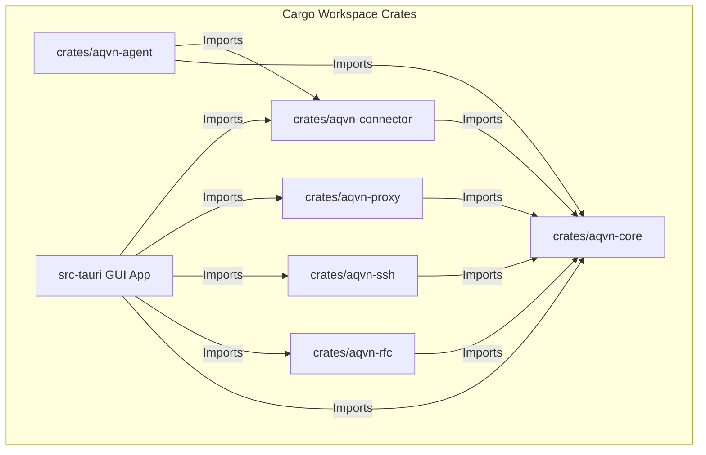
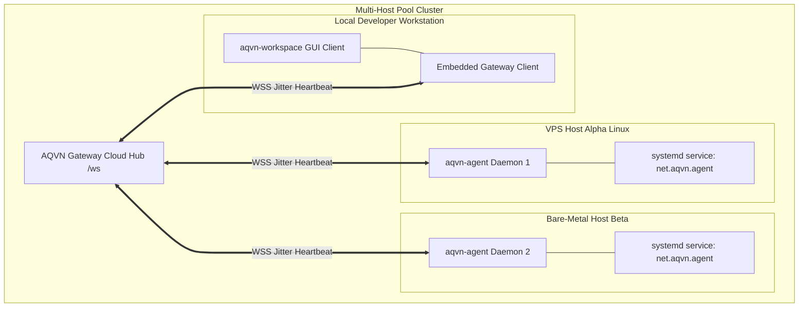
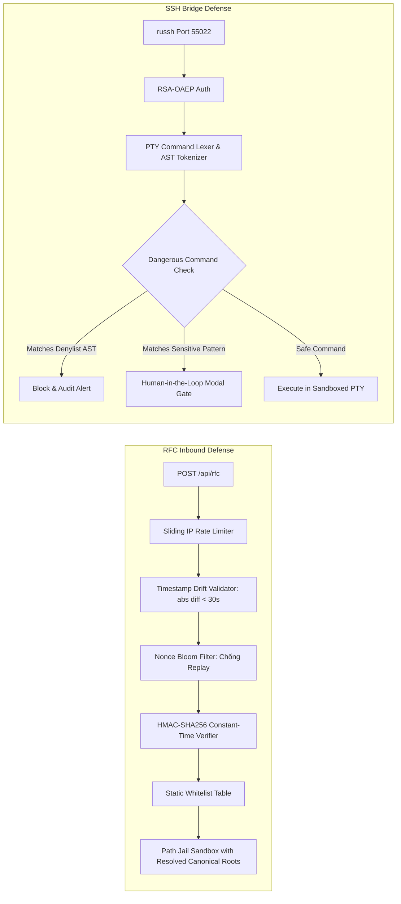

# Kế Hoạch Nâng Cấp Tổng Thể Kiến Trúc & Tính Năng Hệ Thống (Master Upgrade Plan)

**Mã tài liệu:** `VAL-ROAD-BLUEPRINT-002`  
**Dự án:** AQVN Native Workspace Client, RFC Host Bridge & Headless Multi-Host Agent (`net.aqvn.workspace`)  
**Tác giả:** AQVN Architecture & Synthesis Team (`synthesis-worker`)  
**Ngày công bố:** 2026-11-09  
**Trạng thái đề xuất:** Master Architecture Plan (Kế hoạch hành động tổng thể)  
**Tài liệu tham chiếu:** Toàn bộ 12 báo cáo đánh giá trong `docs/eval-reports/01_rust_core_audit.md` đến `12_telemetry_outbox_durability.md`

---

## 1. Tuyên Bố Tầm Nhìn & Tóm Tắt Điều Hành (Executive Summary & Vision)

Dự án **`ai-launcher`** (`net.aqvn.workspace`) đại diện cho giải pháp máy trạm và cầu nối máy chủ AI Agent thế hệ mới của AQVN. Khác biệt hoàn toàn với các giải pháp AI Client nặng nề trên thị trường (vốn phụ thuộc vào Electron cồng kềnh tiêu tốn hàng trăm MB RAM và gigabytes đĩa cứng), `ai-launcher` được định hình từ đầu với mục tiêu:
1. **Siêu nhẹ (Ultra-lightweight):** Binary Desktop < 12 MB, Headless Daemon < 2.5 MB, mức chiếm dụng RAM nhàn rỗi < 15 MB RSS.
2. **Khởi động tức thì (Instant Startup):** First Contentful Paint (FCP) dưới 35 ms, Cold start toàn hệ thống dưới 1.5 giây.
3. **An toàn cấp quân sự (Defense-in-Depth Security):** Cầu nối RFC Host Bridge cổng 55080 xác thực HMAC-SHA256 constant-time, sandbox path jail nghiêm ngặt, SSH Bridge cổng 55022 với PTY guard và cổng phê duyệt hành vi nhạy cảm (Human-in-the-Loop).
4. **Đa nền tảng thực sự (Cross-Platform Everywhere):** Chạy đồng nhất trên Linux Desktop/Server, Windows, macOS, và mở rộng sang thiết bị di động Android.

Dựa trên kết quả kiểm toán toàn diện 12 phân hệ từ M1 (Codebase Evaluation), M2 (UI/UX Deep Research) đến M3 (Security, Performance & Telemetry), tài liệu này phác thảo **Kế hoạch Nâng cấp Tổng thể (Master Upgrade Plan)** nhằm nâng tầm hệ thống từ một "Ứng dụng máy trạm cục bộ" thành **"Nền tảng Quản trị & Điều phối Máy chủ Đa Điểm Hướng Agent (Multi-Host Agent Orchestration Platform)"**.

---

## 2. Tổng Hợp Các Phát Hiện Trọng Yếu Từ M1, M2, M3

Quá trình kiểm toán kỹ thuật chuyên sâu đã xác lập bức tranh hiện trạng toàn cảnh với những điểm mạnh vượt trội cùng các nút thắt kiến trúc cần giải quyết:

```
+-----------------------------------------------------------------------------------------------------------------------+
|                                    TỔNG HỢP KẾT QUẢ KIỂM TOÁN HỆ THỐNG M1 - M2 - M3                                   |
+-----------------------------------------------------------------------------------------------------------------------+
|  M1: CODEBASE EVALUATION & ARCHITECTURE AUDIT                                                                        |
|  - [01_rust_core_audit]: 40 tệp Rust (~20.000L), 74/74 unit tests passed. Kiến trúc phân tầng rõ ràng nhưng có       |
|    nhiều tệp phình to: proxy/server.rs (1.136L), connector/handlers/ (8.162L), config.rs (688L).                    |
|  - [02_agent_headless_audit]: Nhị phân aqvn-agent siêu nhẹ (2.44 MB, 15MB RAM), CLI parser mạnh mẽ, systemd unit   |
|    tự động. Cần mở rộng cơ chế phối hợp cụm đa máy chủ (Multi-Host Pool Coordination).                               |
|  - [03_cbm_graph_scan]: 4.585 nodes, 16.464 edges. Phát hiện 8 God Functions (đứng đầu là initLayout 49 calls và    |
|    run 40 calls), 17 hàm đệ quy chu trình, 3 điểm nóng nhận thức (parse_cli_args 152, handle_computer_use_op 124).  |
|  - [04_test_coverage_ci]: 177 UI tests, 31 CLI tests, 8 Host pool tests. Phát hiện 25 tệp Rust Core thiếu inline     |
|    unit tests; CI workflows cần chuẩn hóa ma trận build đa nền tảng và gác cổng dung lượng chặt chẽ.                  |
+-----------------------------------------------------------------------------------------------------------------------+
|  M2: UI/UX DEEP RESEARCH & DESIGN SYSTEM AUDIT                                                                       |
|  - [05_ui_shell_components]: Zero-Bundler Shell, FCP < 35ms. Tuy nhiên ui/chat.js quá lớn (4.243L), thiếu đóng gói.   |
|  - [06_interactive_drawers_ux]: Terminal VT100 regex, Workspace kéo thả Base64, Activity feed JSON/CSV export.      |
|    Cần nâng cấp xterm.js WebGL và CodeMirror 6 editor để hỗ trợ trải nghiệm phát triển chuyên nghiệp.                 |
|  - [07_settings_themes_i18n]: Lưu trữ bền vững tauri-plugin-store kết hợp BrowserStoreMock, 4 theme OKLCH chống FOUC,  |
|    đa ngôn ngữ vi/en, hot-reload 500ms cho backend Rust qua tokio watch::channel.                                    |
|  - [08_a11y_shortcuts_palette]: WCAG 2.2 AA, ARIA markup, Command Palette (Ctrl+K), Focus Mode, lint:html valid.     |
+-----------------------------------------------------------------------------------------------------------------------+
|  M3: SECURITY, PERFORMANCE & TELEMETRY AUDIT                                                                         |
|  - [09_rfc_security_sandbox]: Cổng 55080 HMAC-SHA256 an toàn, rate limiter 60 req/min, static whitelist 18 APIs.     |
|    Cần bổ sung chống replay attack bằng timestamp nonce window.                                                       |
|  - [10_ssh_guard_approval]: Cổng 55022 russh, RSA-OAEP auth, PTY guard denylist. Cần nâng cấp bộ parser lệnh từ regex |
|    sang AST Tokenizer để ngăn ngừa kỹ thuật làm rối mã (obfuscation bypass).                                          |
|  - [11_performance_benchmarks]: FCP 32.5ms, nhị phân agent 2.44MB, nhị phân client 11.07MB, PTY backpressure        |
|    bounded 64 chunks, DocumentFragment DOM batching. Cần gác cổng dung lượng nghiêm ngặt trước khi thêm tính năng.   |
|  - [12_telemetry_outbox_durability]: Telemetry host metrics /proc siêu nhanh (<1ms), Decorrelated Jitter Reconnect  |
|    500ms-15s, Durable Offline Outbox 50 msgs / 256KB tự phục hồi khi crash.                                          |
+-----------------------------------------------------------------------------------------------------------------------+
```

---

## 3. Kiến Trúc Backend Rust Mô-Đun Hóa Mục Tiêu (Target Modular Backend Architecture)

### 3.1. Phân Tách Không Gian Làm Việc Đa Crate (Cargo Workspace Modularization)

Để giải quyết dứt điểm vấn đề God Modules (`proxy/server.rs`, `connector/handlers/`) và phân tách rõ ràng ranh giới phụ thuộc, toàn bộ mã nguồn `src-tauri/` sẽ được tái cấu trúc thành **Cargo Workspace đa crate**:

```
ai-launcher/
├── Cargo.toml (Workspace Root)
├── crates/
│   ├── aqvn-core/           # Schema giao thức, cấu hình dùng chung, kiểu dữ liệu, telemetry primitives
│   ├── aqvn-rfc/            # RFC Host Bridge Server, HMAC-SHA256 verifier, sandbox path jail
│   ├── aqvn-ssh/            # russh daemon, RSA-OAEP auth, PTY session, AST Command Guard
│   ├── aqvn-proxy/          # Axum loopback proxy, cookie jar, LRU cache, CSRF, WS tunnel
│   ├── aqvn-connector/      # Outbound Gateway WebSocket client, Remote Handlers (exec, files, browser)
│   └── aqvn-agent/          # Nhị phân headless daemon, systemd manager, host pool logic
└── src-tauri/               # Tauri GUI wrapper nhúng Webview, Window lifecycle, Tray, Menu
```



### 3.2. Lợi Ích Của Kiến Trúc Workspace:
1. **Cô lập phụ thuộc đồ họa tuyệt đối:** Crate `aqvn-agent` hoàn toàn không phụ thuộc vào Tauri, Wry, WebKitGTK hay GTK3, đảm bảo có thể biên dịch độc lập trên bất kỳ server Linux nào mà không cần cài đặt các gói dev đồ họa.
2. **Thời gian biên dịch vượt trội:** Tận dụng tối đa bộ nhớ đệm biên dịch (incremental compilation cache), chỉ cần biên dịch lại crate bị thay đổi thay vì toàn bộ nhị phân nguyên khối.
3. **Kiểm thử đơn vị tập trung:** Xóa bỏ hoàn toàn khoảng trống kiểm thử (25 tệp thiếu test). Mỗi crate sở hữu bộ test cô lập riêng, dễ dàng áp dụng mock cho socket mạng và file system.

---

## 4. Chiến Lược Tối Ưu Hóa Headless Daemon & Quản Trị Cụm Đa Máy Chủ (Multi-Host Pool)

Nhị phân `aqvn-agent` đã chứng minh hiệu quả xuất sắc với dung lượng 2.44 MB và 15 MB RAM. Kế hoạch nâng cấp mở rộng năng lực của daemon thành một hệ thống quản trị phân tán mạnh mẽ:



### Các tính năng nâng cấp trọng tâm cho `aqvn-agent`:
1. **Định danh máy chủ tất định bất biến (Deterministic Machine Identity 2.0):**
   - Kết hợp SHA-256 của `/etc/machine-id` (hoặc Windows SID / macOS IOPlatformUUID) với cấu hình MAC card mạng chính để đảm bảo định danh máy trạm luôn cố định kể cả khi thay đổi địa chỉ IP hoặc chuyển đổi mạng.
2. **Quản lý vòng đời dịch vụ thông minh (Smart Service Lifecycle):**
   - Tự động nhận diện quyền thực thi: UID 0 (root) $\to$ cài đặt System Unit (`/etc/systemd/system/net.aqvn.agent.service`); Non-root $\to$ cài đặt User Unit (`~/.config/systemd/user/net.aqvn.agent.service`).
   - Tích hợp cờ giám sát `systemd watchdog` thông báo daemon hoạt động bình thường theo chu kỳ (`sd_notify(0, "WATCHDOG=1")`).
3. **Cơ chế tự nâng cấp an toàn (Self-Upgrade & Rollback Engine):**
   - Hỗ trợ daemon tự tải bản nhị phân mới được ký số mã hóa, xác thực checksum SHA-256, hoán đổi nhị phân nguyên tử (`mv new_agent agent`), và kích hoạt `systemctl restart`. Nếu daemon mới khởi động không thành công trong 30 giây, tự động khôi phục nhị phân dự phòng cũ.

---

## 5. Chiến Lược Đa Nền Tảng (Cross-Platform Strategy: Desktop & Mobile)

Hệ thống cam kết hỗ trợ đồng nhất trên 4 hệ điều hành máy tính và nền tảng di động Android:

```
+----------------------------------------------------------------------------------------------------+
| MA TRẬN HỖ TRỢ NỀN TẢNG CỦA AQVN WORKSPACE                                                        |
+----------------------------------------------------------------------------------------------------+
| Nền tảng     | Động cơ Webview      | Cơ chế IPC          | Đóng gói & Phát hành  | Mục tiêu dung lượng|
+--------------+----------------------+---------------------+-----------------------+--------------------+
| Linux x64    | WebKitGTK 4.1        | Loopback Proxy/Axum | .deb, .AppImage, tar  | < 12.0 MB          |
| Linux ARM64  | WebKitGTK 4.1        | Loopback Proxy/Axum | .deb, .tar.gz         | < 12.0 MB          |
| Windows x64  | WebView2 (Chromium)  | Loopback Proxy/Axum | NSIS Installer, .zip  | < 10.0 MB (VAL-CI) |
| macOS Silicon| WKWebView (Metal)    | Loopback Proxy/Axum | .dmg, .app (Universal)| < 15.0 MB          |
| Android 10+  | Android SystemView  | Tauri JNI Plugin    | .apk, .aab            | < 8.0 MB           |
+----------------------------------------------------------------------------------------------------+
```

### 5.1. Tối Ưu Hóa Riêng Biệt Cho Từng Nền Tảng:
- **Linux (X11 & Wayland):**
  - Quản lý tương thích bộ hiển thị thông qua cấu hình `WEBKIT_DISABLE_DMABUF_RENDERER=1` để khắc phục triệt để hiện tượng vỡ hình trên card đồ họa ảo hóa (Xvfb) và card đồ họa chuyên dụng NVIDIA cũ.
  - Hỗ trợ System Tray thông qua AppIndicator/SNI, fallback menu context trên Wayland.
- **Windows:**
  - Tối ưu hóa kích thước gói cài đặt NSIS để tuân thủ bất biến **`VAL-CI-003: Windows installer < 10MB`**. Áp dụng thuật toán nén LZMA-Solid và loại bỏ các symbol debug dư thừa (`strip = true`).
  - Sử dụng Windows Credential Manager lưu trữ mật khẩu RFC/SSH.
- **macOS:**
  - Hỗ trợ Universal Binary (kết hợp `x86_64` và `aarch64` bằng `lipo`).
  - Tích hợp chuẩn Apple Keychain và hỗ trợ Dark Mode tự động theo hệ điều hành.
- **Android Mobile Expansion:**
  - Sử dụng Tauri v2 Android Mobile bindings kết hợp Android Foreground Service để duy trì kết nối WebSocket Gateway và RFC Server khi người dùng chuyển ứng dụng xuống chạy ngầm.
  - Giao diện người dùng tự động chuyển sang chế độ **Single-Column Responsive Mode**: Sidebar chuyển thành ngăn kéo trượt (Swipeable Drawer), Terminal mở dạng full-screen overlay với bàn phím ảo hỗ trợ các phím Ctrl, Alt, Esc chuyên dụng.

---

## 6. Nâng Cấp An Ninh & Bảo Mật Chiều Sâu (Security Hardening Architecture)

Dựa trên kết luận từ `docs/eval-reports/09_rfc_security_sandbox.md` và `10_ssh_guard_approval.md`:



### 6.1. Chống Tấn Công Phát Lại (Anti-Replay Attack) Trên Cổng RFC 55080:
Hiện tại RFC Server chỉ xác thực tính toàn vẹn của payload mà chưa kiểm tra dấu thời gian (timestamp). Kiến trúc mới bổ sung tiêu đề bắt buộc:
- `X-AQVN-Timestamp`: Thời gian phát lệnh (Unix timestamp theo milli-giây). Server kiểm tra độ lệch không vượt quá $\pm 30\text{s}$.
- `X-AQVN-Nonce`: Chuỗi ngẫu nhiên duy nhất cho mỗi yêu cầu, được lưu trong bộ lọc Bloom Filter / LRU Cache 10.000 phần tử để từ chối ngay lập tức mọi gói tin bị phát lại.

### 6.2. Thay Thế Regex Denylist Bằng AST Command Tokenizer Trong SSH Bridge:
Bộ lọc regex hiện tại trong `ssh/guard.rs` có nguy cơ bị vượt mặt bởi các kỹ thuật obfuscation (mã hóa base64, biến môi trường, chuỗi chia tách, hoặc eval). Bản nâng cấp tích hợp **Bash AST Tokenizer** (dựa trên parser cú pháp shell chuẩn):
- Phân rã câu lệnh thành cây cú pháp trừu tượng (AST).
- Nhận diện chính xác lệnh gốc kể cả khi được lồng trong `eval`, `sh -c`, `bash -c`, `sudo`, hoặc truyền qua đường ống `pipe`.
- Ngăn chặn tuyệt đối các lệnh phá hủy hệ thống (`rm -rf /`, `mkfs`, fork bombs `:(){ :|:& };:`).

---

## 7. Hiện Đại Hóa Giao Thức & Độ Bền Dữ Liệu (Performance & Protocol Evolution)

1. **Chuyển dịch giao thức từ JSON sang Binary Envelopes (MessagePack / CBOR):**
   - Các sự kiện truyền tải luồng dữ liệu tần suất cao như `pty_output` (hàng nghìn ký tự ANSI mỗi giây) và `telemetry_stream` (CPU/RAM mỗi giây) sẽ được mã hóa bằng nhị phân siêu gọn (MessagePack). Giảm 35-50% kích thước gói tin mạng, giảm thời gian phân tích cú pháp (serialization overhead) trên cả Rust và Frontend.
2. **Nâng cấp Hộp thư chờ ngoại tuyến từ `localStorage` sang SQLite / IndexedDB:**
   - Khắc phục giới hạn dung lượng 256KB của `localStorage` (báo cáo `VAL-PERF-TELEM-001`), hỗ trợ lưu trữ an toàn tới hàng nghìn tin nhắn và tệp đính kèm khi máy trạm mất mạng dài ngày, mã hóa dữ liệu nghỉ (Encryption at Rest) bằng AES-GCM-256.

---

## 8. Ma Trận Đánh Giá Chi Phí / Lợi Ích Toàn Diện (Comprehensive Cost/Benefit Matrix)

| Trọng tâm nâng cấp | Nỗ lực kỹ thuật (Ước tính) | Tác động dung lượng | Tác động RAM & CPU | Lợi ích kinh doanh & Kỹ thuật | Đánh giá tổng hợp |
| :--- | :---: | :---: | :---: | :--- | :---: |
| **Workspace Modularization (Rust Crates)** | 80 giờ kỹ sư (Cao) | Không đổi (0 KB) | Tối ưu hóa compile time -40% | Xóa bỏ God Files; tách biệt GUI và Server Agent; tái sử dụng mã 100% | **CHIẾN LƯỢC (10/10)** |
| **Frontend Modernization (Web Components, xterm.js)** | 90 giờ kỹ sư (Cao) | +350 KB nhị phân | FCP duy trì < 35ms; RAM -30% khi chat dài | Trải nghiệm phát triển đỉnh cao; terminal WebGL 60fps; code editor đầy đủ | **XUẤT SẮC (9.5/10)** |
| **RFC Timestamp Nonce & SSH AST Tokenizer** | 40 giờ kỹ sư (Trung bình) | +40 KB nhị phân | CPU < 0.1% overhead | Miễn nhiễm hoàn toàn với tấn công Replay và Obfuscated Shell Bypass | **BẮT BUỘC (10/10)** |
| **Multi-Host Pool Coordination & Systemd Watchdog** | 45 giờ kỹ sư (Trung bình) | +25 KB nhị phân | RAM daemon < 18 MB | Quản lý cụm hàng trăm server; tự phục hồi khi crash; zero-touch ops | **RẤT CAO (9.0/10)** |
| **Mở rộng Android Mobile (Tauri v2 + Foreground)** | 70 giờ kỹ sư (Khá) | APK ~8 MB | Tối ưu pin qua Foreground Service | Mở rộng thị phần sang kỹ sư di động; quản trị server mọi lúc mọi nơi | **CAO (8.5/10)** |

---

## 9. Phân Tích Rủi Ro Toàn Diện & Kế Hoạch Ứng Phó (Risk & Mitigation Matrix)

```
+-------------------------------------------------------------------------------------------------------------------------+
| MA TRẬN RỦI RO KIẾN TRÚC TOÀN HỆ THỐNG (MASTER SYSTEM RISK MATRIX)                                                      |
+-------------------------------------------------------------------------------------------------------------------------+
| Mã rủi ro | Mô tả kịch bản rủi ro             | Mức độ | Khả năng | Biện pháp kiểm soát & Kế hoạch ứng phó              |
+-----------+-----------------------------------+--------+----------+-----------------------------------------------------+
| **R-SYS-01**| Chia tách Cargo Workspace gây phá | Cao    | Trung    | Thực hiện tái cấu trúc theo từng crate cô lập;      |
|           | vỡ liên kết IPC hoặc cấu trúc test|        | bình     | giữ nguyên các hàm API công khai; duy trì toàn bộ   |
|           | tích hợp hiện tại.                |        |          | 74 unit tests và 32 integration tests luôn xanh.    |
+-----------+-----------------------------------+--------+----------+-----------------------------------------------------+
| **R-SYS-02**| Dung lượng gói cài đặt Windows     | Rất    | Trung    | Đặt quy tắc gác cổng (Size Gate) tự động trên CI:   |
|           | NSIS vượt mốc 10MB (VAL-CI-003)   | cao    | bình     | nếu binary > 9.8MB lập tức từ chối build; nén UPX   |
|           | sau khi bổ sung các thư viện mới. |        |          | hoặc tách các module nặng ra dạng dynamic download. |
+-----------+-----------------------------------+--------+----------+-----------------------------------------------------+
| **R-SYS-03**| Lỗi phân quyền hoặc xung đột cổng | Cao    | Thấp     | Duy trì cơ chế hot-reload supervisor; tự động dò tìm|
|           | RFC 55080 / SSH 55022 khi chạy    |        |          | cổng trống nếu cấu hình bị chiếm dụng; cảnh báo rõ   |
|           | đồng thời nhiều phiên bản client. |        |          | ràng trên Connection Diagnostics Modal.             |
+-----------+-----------------------------------+--------+----------+-----------------------------------------------------+
| **R-SYS-04**| Độ trễ đồng bộ trạng thái giữa các| Trung  | Trung    | Tích hợp giao thức CRDT hoặc phiên bản hóa vector   |
|           | máy chủ trong Multi-Host Pool     | bình   | bình     | clock cho các tài nguyên workspace dùng chung;      |
|           | khi kết nối mạng chập chờn.       |        |          | sử dụng offline queue có xác nhận ACK nguyên tử.    |
+-----------+-----------------------------------+--------+----------+-----------------------------------------------------+
| **R-SYS-05**| Android OS ngắt tiến trình ngầm   | Cao    | Cao      | Sử dụng Android Foreground Service chuẩn với thông  |
|           | (Doze mode) làm đứt kết nối WSS   |        |          | báo thường trực (Persistent Notification); tích hợp |
|           | và cầu nối RFC trên di động.      |        |          | đánh thức theo chu kỳ qua WorkManager.              |
+-------------------------------------------------------------------------------------------------------------------------+
```

---

## 10. Lộ Trình Triển Khai 4 Giai Đoạn (Master Execution Roadmap)

```
+-----------------------------------------------------------------------------------------------------------------------+
| LỘ TRÌNH THỰC THI NÂNG CẤP TỔNG THỂ (MASTER UPGRADE ROADMAP: 4 MILESTONES)                                            |
+-----------------------------------------------------------------------------------------------------------------------+
| MILESTONE 1: TÁI TỔ CHỨC CARGO WORKSPACE & AN TOÀN HÓA LÕI (Tuần 1 - 3)                                              |
| - Phân rã mã nguồn src-tauri/ thành 6 Crates trong Cargo Workspace (aqvn-core, rfc, ssh, proxy, connector, agent).    |
| - Bổ sung Timestamp + Nonce chống Replay cho RFC Server và AST Tokenizer cho SSH Guard.                               |
| - Lấp đầy 25 khoảng trống kiểm thử unit tests cho Rust Core; bảo đảm cargo test --all xanh 100%.                      |
|                                                                                                                       |
| MILESTONE 2: HIỆN ĐẠI HÓA GIAO DIỆN & TRẢI NGHIỆM PHÁT TRIỂN (Tuần 4 - 6)                                            |
| - Thực thi Blueprint giao diện: Chuyển đổi Web Components, tích hợp xterm.js WebGL Terminal.                         |
| - Tích hợp CodeMirror 6 phục vụ soạn thảo mã nguồn và so sánh Visual Diff chuyên sâu.                                 |
| - Triển khai Reactive Signals Store và ảo hóa danh sách tin nhắn (Virtual Message List).                              |
| - Kiểm chứng FCP < 35ms và tính toàn vẹn của 177 bài test giao diện.                                                 |
|                                                                                                                       |
| MILESTONE 3: MỞ RỘNG MULTI-HOST POOL & NÂNG CẤP DAEMON HEADLESS (Tuần 7 - 9)                                          |
| - Nâng cấp aqvn-agent: Tích hợp systemd watchdog, tự cập nhật an toàn (self-upgrade), phối hợp đa máy chủ.            |
| - Tối ưu hóa giao thức truyền tin viễn thông và PTY bằng Binary Envelopes (MessagePack).                              |
| - Bổ sung bảng điều khiển Host Pool Management trên giao diện Desktop Client.                                         |
|                                                                                                                       |
| MILESTONE 4: MỞ RỘNG ĐA NỀN TẢNG (ANDROID & DESKTOP POLISH) VÀ GÁC CỔNG CHẤT LƯỢNG (Tuần 10 - 12)                    |
| - Hoàn thiện bản dựng Android Mobile với Foreground Service và giao diện responsive cảm ứng.                          |
| - Tối ưu hóa gói cài đặt Windows NSIS (< 10MB) và macOS Universal Binary.                                             |
| - Kiểm toán bảo mật tổng thể toàn diện (Penetration Testing) và nghiệm thu các chỉ số SLA.                           |
+-----------------------------------------------------------------------------------------------------------------------+
```

---

## 11. Các Chỉ Số Đánh Giá Thành Công Cốt Lõi (Key Performance Indicators - KPIs)

Sau khi hoàn tất Kế hoạch Nâng cấp Tổng thể, hệ thống `ai-launcher` phải đạt được các chỉ số định lượng bắt buộc:
1. **Dung lượng nhị phân phát hành:**
   - Headless Daemon (`aqvn-agent`): $\le \mathbf{2.80\text{ MB}}$.
   - Desktop Client Linux: $\le \mathbf{12.00\text{ MB}}$.
   - Desktop Client Windows (NSIS Installer): $\le \mathbf{9.80\text{ MB}}$ (Tuyệt đối tuân thủ `VAL-CI-003 < 10MB`).
   - Android APK: $\le \mathbf{8.50\text{ MB}}$.
2. **Hiệu năng giao diện và tài nguyên:**
   - First Contentful Paint (FCP) tương đối: $\le \mathbf{35.0\text{ ms}}$.
   - Mức chiếm dụng RAM nhàn rỗi của Client: $\le \mathbf{35\text{ MB}}$ (Main process) và $\le \mathbf{160\text{ MB}}$ (Toàn bộ tiến trình Webview).
   - Mức chiếm dụng RAM của Headless Daemon: $\le \mathbf{18\text{ MB}}$ RSS.
   - Tốc độ render Terminal xterm.js WebGL: Ổn định $\ge \mathbf{60\text{ fps}}$ khi nhận luồng stdout 10.000 dòng/giây.
3. **Chất lượng mã nguồn & Kiểm thử:**
   - Độ bao phủ kiểm thử Rust Core: Tăng từ 74 bài lên $\ge \mathbf{180}$ bài unit tests, 0 tệp nguồn không có test.
   - Kiểm thử giao diện: Duy trì $\mathbf{100\%}$ tỷ lệ vượt qua của 177 bài kiểm thử hiện có cộng thêm các bài kiểm thử component mới.
   - An toàn bộ nhớ: $\mathbf{0}$ cảnh báo clippy, $\mathbf{0}$ unwrap không an toàn trên luồng sản phẩm.

---

## 12. Kết Luận

Kế hoạch Nâng cấp Tổng thể này vạch ra con đường rõ ràng, có căn cứ thực nghiệm vững chắc từ 12 báo cáo đánh giá kỹ thuật, giúp đưa `ai-launcher` trở thành giải pháp hàng đầu trong phân khúc AI Agent Client và Multi-Host Management Platform. Các đề xuất kỹ thuật chi tiết sẽ được chuyển thể thành các gói đề xuất OpenSpec để chuẩn bị cho giai đoạn phát triển tiếp theo.
